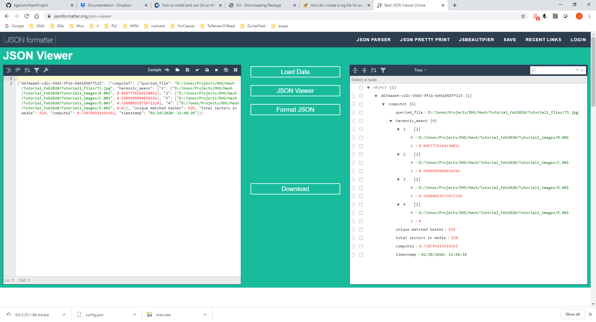
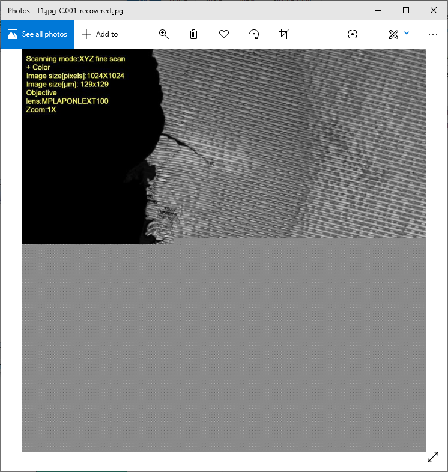
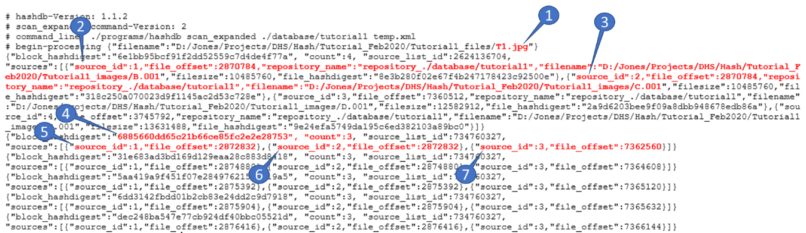

# dfmt — Digital Forensics Sector Hashing Tool

A tool I built and tested as part of my Graduate Research Assistantship, for sector-hashing disk images so investigators can search for deleted or partial files — surfacing evidence that can support probable cause for a search warrant even when files have been deleted or only exist in fragments.

## What it does

dfmt builds hash databases from disk images at the sector level (not just whole-file hashes), so a file can be identified even if it's been deleted, fragmented, or only partially overwritten. It's built on top of [NPS hashdb](https://github.com/NPS-DEEP/hashdb) and `md5deep` for the underlying hashing engine. It supports:

- Creating and deleting hash catalogs
- Loading multiple disk images into a catalog (with duplicate-load prevention)
- Querying multiple files against a catalog to check for matches, including partial/sector-level matches

## Two interfaces

- **`dfmt/`** — a packaged Python module (Flask + Flask-RESTX) exposing the same functionality as a REST API, so it can be driven from Postman, curl, or any HTTP client rather than only a local GUI. See [DfmtAPIDocs.md](DfmtAPIDocs.md) for full setup and usage, including authentication and example requests.
- An earlier version was a standalone desktop GUI (Tkinter) with the same core hashing/query logic.

## Example: Worked Test Case

I tested dfmt against a multi-image scenario: eight disk images imaged from four individuals' drives, on two different days 25 days apart. Seven of the eight images were loaded into the catalog; the eighth was set aside purely to pull known test files from, so I could query for files whose true presence or absence on each image was already known going in.

Querying one test file (`T1.jpg`) against the catalog returned:

| Image | Score | What it means |
| --- | --- | --- |
| B.001 | 0.85 | Strong match - most of the file's data still recoverable |
| C.001 | 0.59 | Partial match - file had been roughly half-overwritten |
| D.001 | 0.16 | Weak match - only a small fragment present |
| E.001 | 0.0 | At least one sector matched, but not enough to produce a meaningful score |
| F.001 | (not returned) | No sectors from the file found at all |

Score is 0.0-1.0: higher means more of the original file's data is still present on that image.

I manually verified these results in a hex editor, confirming the matched sectors' byte offsets and hash values lined up between the query file and each disk image. For C.001, I extracted just the surviving sectors and rendered them as an image file - confirming a real, visually-verifiable partial recovery of a file that had been half-overwritten:

I also broke down the underlying hashdb raw output to show exactly how sector-level hash matches map back to each source image - the data the score computation is built on:

Full write-up, including tool setup and step-by-step walkthrough with hex-editor verification: [DfmtTestCase2.docx](DfmtTestCase2.docx)

## Dependencies

The hashing backend (`hashdb`, `md5deep64`, `trunc`) are third-party binaries referenced in `dfmt/config.json` by path — not included in this repo. Source: [NPS-DEEP/hashdb](https://github.com/NPS-DEEP/hashdb), [md5deep](https://github.com/jessek/hashdeep).

## What this demonstrates

Building a working forensic tool end-to-end — from the underlying sector-hashing methodology (Garfinkel, *Using Purpose-Built Functions and Block Hashes to Enable Small Block and Sub-File Forensics*) through to a packaged, documented API that other investigators could actually install and use.
